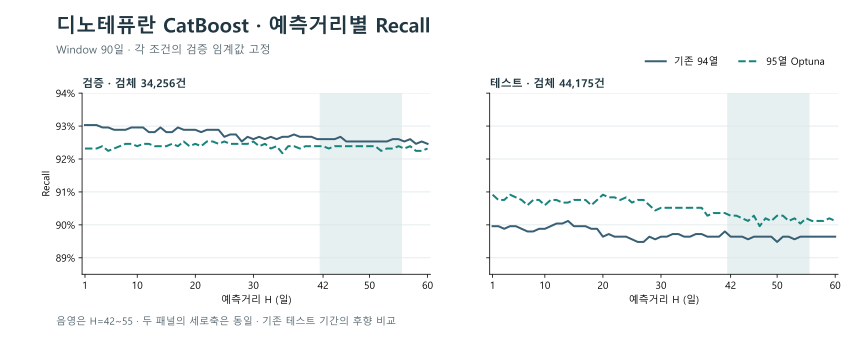

# 05. 성능검증 상세자료

Window 90일에서 기존 94열 CatBoost와 방제 대상명 수를 포함한 95열 Optuna CatBoost를 같은 검체로 비교했습니다. 각 조건에서 검증으로 선정한 임계값을 모든 H와 테스트에 적용했습니다. 테스트는 2025-07-01~2026-06-30에 검사한 검체를 사용한 후향 비교입니다. [과거 자료 사용 이력과 별도 독립평가 현황](../07_독립평가데이터_현황/README.md)

| 파일 | 범위 |
| --- | --- |
| [`summary.csv`](summary.csv) | 두 모델 × 검증·테스트 × 전체 H·H=60·H=42~55의 집계 12행 |
| [`per_horizon.csv`](per_horizon.csv) | 두 모델 × 검증·테스트 × H=1~60의 개별 지표 240행 |
| [`recall_by_horizon.svg`](recall_by_horizon.svg) | 두 모델의 검증·테스트 H별 Recall 추이 |

## 평가 단위와 적용한 임계값

검체의 기준일 M에 대해 예측거리 H일마다 예측 기준일을 `D = M − H`로 계산하고, 해당 날짜에 맞게 구성한 입력으로 검출 여부를 예측했습니다. 같은 검체의 실제 검사 결과는 60개 H에 공통으로 사용합니다. [분할 기간과 날짜 예시](../03_학습검증평가데이터_분할정보/README.md)

| 분할 | 전체 검체 | 검출 검체 | 전체 H 평가쌍 | H=60 평가쌍 | H=42~55 평가쌍 |
| --- | ---: | ---: | ---: | ---: | ---: |
| 검증 | 34,256 | 1,406 | 2,055,360 | 34,256 | 479,584 |
| 테스트 | 44,175 | 1,255 | 2,650,500 | 44,175 | 618,450 |

예를 들어 테스트 전체 H의 실제 검출 평가쌍은 `1,255 × 60 = 75,300`입니다. H=60의 미탐지·오탐은 검체 건수로 읽을 수 있습니다. 전체 H와 H=42~55에서는 같은 검체를 여러 H에서 평가하므로 미탐지·오탐은 검체×H의 평가쌍 수로 읽습니다.

기존 94열 임계값은 `0.04830527678132057`, 95열 Optuna 임계값은 `0.0583612434566021`입니다. 두 모델 모두 각자 정한 임계값 이상의 확률을 검출로 분류했습니다. [95열 모델 선정 기준](../02_학습모델파일/README.md)

## 전체 H=1~60 성과

| 분할 | 조건 | Recall | Precision | PR-AUC | 미탐지 FN | 오탐 FP |
| --- | --- | ---: | ---: | ---: | ---: | ---: |
| 검증 | 기존 94열 | 92.73% | 12.13% | 0.2590 | 6,135 | 566,582 |
| 검증 | 95열 Optuna | 92.39% | 12.13% | 0.2736 | 6,420 | 564,697 |
| 테스트 | 기존 94열 | 89.73% | 8.14% | 0.1796 | 7,733 | 762,857 |
| 테스트 | 95열 Optuna | 90.50% | 8.17% | 0.2046 | 7,150 | 766,217 |

검증 전체 H에서 95열 Optuna의 Recall은 0.34%p 낮았고 미탐지 285개가 늘었습니다. 오탐은 1,885개 줄고 PR-AUC는 0.0145 높았습니다. 두 모델의 Precision은 표에서 12.13%로 표시되며, 원정밀도 값은 각각 12.13154%와 12.12815%입니다.

테스트 전체 H에서 95열 Optuna의 Recall은 0.77%p 높았고 PR-AUC는 0.0250 높았습니다. 미탐지 평가쌍이 583개 줄고 오탐 평가쌍이 3,360개 늘었습니다. 방제 대상명 수 추가, 하이퍼파라미터와 검증 임계값의 차이가 함께 반영된 비교입니다.

## H=60 성과

H=60에서는 각 검체의 기준일 M에서 60일을 뺀 예측 기준일 `D = M − 60`에 맞춰 입력을 구성하고 한 번씩 예측했습니다.

| 분할 | 조건 | Recall | Precision | PR-AUC | 미탐지 FN | 오탐 FP |
| --- | --- | ---: | ---: | ---: | ---: | ---: |
| 검증 | 기존 94열 | 92.46% | 12.24% | 0.2591 | 106 | 9,318 |
| 검증 | 95열 Optuna | 92.32% | 12.15% | 0.2716 | 108 | 9,381 |
| 테스트 | 기존 94열 | 89.64% | 8.21% | 0.1775 | 130 | 12,576 |
| 테스트 | 95열 Optuna | 90.12% | 8.18% | 0.2017 | 124 | 12,693 |

테스트에서 95열 Optuna는 검출 1,255건 중 1,131건을 포착했습니다. 기존 94열과 비교하면 Recall이 0.48%p 높았고 미탐지는 6건 줄었으며 오탐은 117건 늘었습니다.

## H=42~55 성과

검체당 14개 예측거리의 혼동행렬은 합산하고, Recall·Precision·PR-AUC 등 비율과 면적 지표는 H별 값을 산술평균했습니다.

| 분할 | 조건 | 평균 Recall | 평균 Precision | 평균 PR-AUC | 미탐지 FN 합계 | 오탐 FP 합계 |
| --- | --- | ---: | ---: | ---: | ---: | ---: |
| 검증 | 기존 94열 | 92.57% | 12.21% | 0.2606 | 1,463 | 131,020 |
| 검증 | 95열 Optuna | 92.36% | 12.13% | 0.2723 | 1,503 | 131,741 |
| 테스트 | 기존 94열 | 89.62% | 8.16% | 0.1794 | 1,824 | 177,227 |
| 테스트 | 95열 Optuna | 90.18% | 8.17% | 0.2033 | 1,725 | 178,174 |

테스트에서 평균 Recall은 0.56%p 높았고 미탐지는 99평가쌍 줄었으며 오탐은 947평가쌍 늘었습니다. 평균 Precision은 각 H의 Precision을 먼저 계산한 값의 평균이므로, 합산 TP와 FP로 계산한 값과 차이가 날 수 있습니다.



그래프의 x축은 예측거리 H, y축은 해당 H의 검출 포착률입니다. 검증과 테스트를 나눠 그렸고 음영은 H=42~55 구간입니다. 각 H의 점에는 해당 분할의 전체 검체가 반영됩니다.

## 집계표 읽는 법

| 열 또는 값 | 의미 |
| --- | --- |
| `split` | `validation`은 검증, `test`는 테스트 |
| `model` | `기존 94열` 또는 `95열 Optuna` |
| `H` | 개별 H의 예측거리(일). 검체 기준일 M의 H일 전을 예측 기준일로 사용 |
| `scope=all_h` | H=1~60의 검체×H 평가쌍을 합쳐 지표 계산 |
| `scope=h60` | H=60의 검체당 예측 1회 |
| `scope=h42_55` | 14개 H에서 각각 계산한 비율의 산술평균과 건수의 합계 |
| `specimens`, `positive_specimens` | 분할 전체의 실제 검체 수 및 검출 검체 수 |
| `N`, `TP`, `FN`, `FP`, `TN` | 해당 H 범위의 전체 평가쌍과 혼동행렬 건수 |
| `threshold` | 검증에서 정한 원정밀도 임계값. 확률이 이 값 이상이면 검출 판정 |

### 판정 지표와 계산 예시

TP는 검출을 검출로 맞힌 수, FN은 실제 검출을 놓친 수입니다. FP는 불검출을 검출로 판정한 수, TN은 불검출을 불검출로 맞힌 수입니다. 네 건수의 합은 `N`입니다.

| 지표 | 계산과 의미 |
| --- | --- |
| Accuracy | `(TP + TN) / N`. 전체에서 판정이 맞은 비율 |
| Precision | `TP / (TP + FP)`. 검출 예측 중 실제 검출 비율 |
| Recall | `TP / (TP + FN)`. 실제 검출 중 검출 예측으로 포착한 비율 |
| F1 | `2 × TP / (2 × TP + FN + FP)`. Precision과 Recall에 같은 가중치 적용 |
| F4 | `17 × TP / (17 × TP + 16 × FN + FP)`. F1보다 미탐지에 큰 가중치 적용 |
| 검사 축소율 `inspection_reduction` | `TN / N`. 전체 중 불검출을 불검출로 맞힌 비율 |
| ROC-AUC | 원래 확률로 임계값을 바꾸며 얻은 ROC 곡선의 면적 |
| PR-AUC | Precision–Recall 곡선의 사다리꼴 면적 |
| AP | Recall의 변화폭으로 Precision을 가중한 평균정밀도(Average Precision) |

95열 Optuna의 테스트 H=60 행을 보면 `TP=1,131`, `FN=124`, `FP=12,693`, `TN=30,227`입니다. Recall은 `1,131 ÷ 1,255 ≈ 90.12%`, Precision은 `1,131 ÷ 13,824 ≈ 8.18%`, 검사 축소율은 `30,227 ÷ 44,175 ≈ 68.43%`입니다. CSV의 비율·점수는 0~1로 저장돼 있습니다. 전체 H의 ROC-AUC·PR-AUC·AP는 60개 H를 펼친 확률에서 계산합니다.

## 검산

저장소 루트에서 실행합니다.

```bash
python -B "01_소스코드/verify_package.py"
```

명령은 분할·모델별 H=1~60 240행의 구성이 정확한지, 고정 임계값과 분모가 일치하는지, 혼동행렬에서 다시 계산한 지표가 저장 값과 맞는지 확인합니다. 요약 12행은 H별 건수 합계, 전체 H의 혼동행렬 지표, H=60 및 H=42~55의 H별 지표 평균과 대조합니다. ROC-AUC·PR-AUC·AP의 원점수 기반 재계산에는 평가쌍별 확률과 정답이 필요합니다. 공개 실행은 이들 지표의 값 범위와 부분 구간 집계의 일관성을 점검합니다. [공개 점검과 동결 모델 추론 범위](../04_실행환경_실행방법/README.md)
