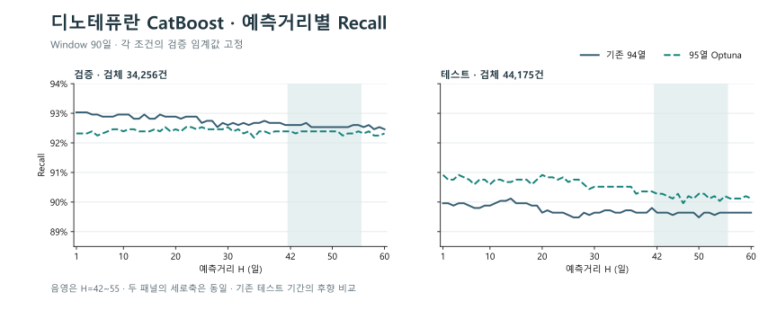

# 디노테퓨란 검출 예측 모델 기술검증 패키지

> **검증 대상** · CatBoost 95열, Window 90일, 검증 Optuna trial 3
>
> **실험 완료** · 2026-11-16
>
> **배포 범위** · 모델 설정, 실행 코드, 합성 입출력, 검증·테스트 집계 및 파일별 해시

식품 검체에서 디노테퓨란이 검출될 가능성을 산출하고 검사 우선순위를 정하는 연구입니다. 기존 94열 모델은 기상·토양과 파생변수를 사용했습니다. 최종 95열 모델은 11.13 목록에서 품목군×세부품목별로 중복을 제거해 계산한 **디노테퓨란 방제 대상명 수**를 추가했습니다.

## 연구에서 수행한 작업

1. **입력 구성** · 예측 기준일 D에 맞춰 기상과 동적 토양의 최근 90일을 요약했습니다. 토양수분 변화량, 토양 온도·수분의 60일 복합지수, 온도별 토양 내 디노테퓨란 소실속도상수의 60일 평균 등을 추가했습니다. 95번째 열은 품목 조합에 연결한 방제 대상명 수이며 집계 목록이 비어 있으면 0입니다.
2. **모델 선정** · 학습 구간에서 처리 기준을 확정하고, 시간 순서로 분리한 검증 구간에서 Optuna 15개 trial을 비교했습니다. Precision 12.1276% 이상에서 Recall을 최대화하고 동률이면 Precision으로 결정했습니다. 선정된 trial 3의 138개 트리와 임계값 `0.0583612434566021`을 고정했습니다.
3. **과거 자료 평가** · 검체 기준일 M에 대해 예측 기준일을 `D = M − H`로 정하고 H=1~60에서 결과를 대조했습니다. 테스트는 2025-07-01~2026-06-30의 44,175검체(검출 1,255건)입니다. 이 구간은 95열 모델이나 임계값 선정에는 사용하지 않았으며, 연구 내 다른 실험에서는 사용된 적이 있습니다.
4. **검증 자료 정리** · 94열과 95열을 같은 검체로 비교했습니다. 집계표는 공개 CSV로 검산할 수 있고, 동일한 동결 모델을 보유한 경우 합성 입력의 예측도 대조할 수 있습니다.

## 전체 H=1~60 합산 결과

| 분할 | 모델 | Recall | Precision | PR-AUC | 미탐지 FN | 오탐 FP |
| --- | --- | ---: | ---: | ---: | ---: | ---: |
| 검증 | 기존 94열 | 92.73% | 12.13% | 0.2590 | 6,135 | 566,582 |
| 검증 | 95열 Optuna | 92.39% | 12.13% | 0.2736 | 6,420 | 564,697 |
| 테스트 | 기존 94열 | 89.73% | 8.14% | 0.1796 | 7,733 | 762,857 |
| 테스트 | 95열 Optuna | 90.50% | 8.17% | 0.2046 | 7,150 | 766,217 |

테스트 2,650,500 평가쌍에서 95열의 Recall은 **0.77%p 상승**했고 미탐지는 **583개 감소**, 오탐은 **3,360개 증가**했습니다. 입력 추가, 튜닝, 임계값 변경이 함께 반영된 결과입니다. 별도 미사용 독립평가 자료는 미확보 상태입니다.



## 제출자료 구성

| 번호 | 자료 | 확인할 내용 |
| --- | --- | --- |
| 00 | [제출자료 확인표](00_제출자료_확인표.md) | 공개 범위와 항목별 접근 상태 |
| 01 | [소스코드](01_소스코드/) | 합성 입력 추론, 집계 검산, 패키지 검증 및 테스트 |
| 02 | [학습모델 파일 및 버전](02_학습모델파일/) | 검증에서 선정한 trial, 95열 모델 설정, 임계값, 모델 SHA-256 |
| 03 | [데이터 분할과 입력 정의](03_학습검증평가데이터_분할정보/) | 연도별 분할 기간, 검체 수, 95열의 순서 및 의미 |
| 04 | [실행환경과 실행방법](04_실행환경_실행방법/) | Python 환경, 명령어, 결과 파일 |
| 05 | [성능검증 상세자료](05_성능검증_상세자료/) | 94·95열의 검증·테스트, 전체 H·H=60·H=42~55, H별 그래프 |
| 06 | [입출력 정의 및 샘플](06_입출력정의_샘플/) | 합성 3행과 동결 모델로 생성한 예제 출력 |
| 07 | [독립평가 데이터 현황](07_독립평가데이터_현황/) | 과거 테스트 자료의 사용 이력과 별도 미사용 평가 자료 현황 |
| 08 | [데이터 처리 및 누수 점검](08_데이터처리_누수점검/) | 시간 경계, 학습 전처리, 소스 가용 시점의 확인 범위 |
| 09 | [검증 대상 버전과 파일 목록](09_검증대상버전_파일목록/) | 배포 파일 목록, 크기 및 SHA-256 |

## 실행

저장소 루트에서 Python으로 공개 파일의 SHA-256, 집계 12행, H별 240행, 합성 입출력 3행을 대조할 수 있습니다.

```bash
python "01_소스코드/verify_package.py"
```

저장 모델 추론에는 CatBoost 실행환경과 SHA-256이 일치하는 동결 모델 파일이 필요합니다. 이 저장소의 공개 범위는 검체 식별 정보가 없는 집계와 합성 자료입니다. [실행환경과 동결 모델 검증 명령](04_실행환경_실행방법/)
